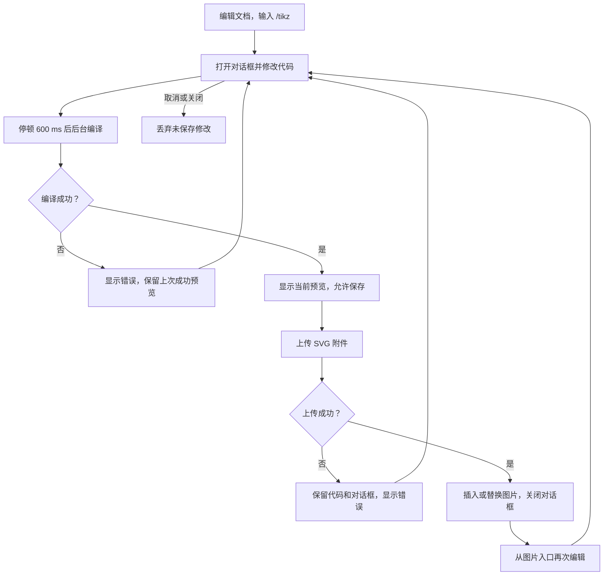
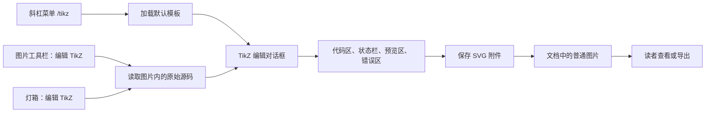

# TikZ 图表 - 产品需求文档（PRD）

## 0. 文档信息

### 0.1 文档状态

| 项目       | 内容                                                        |
| ---------- | ----------------------------------------------------------- |
| 当前版本   | 第 6 稿：增加界面设计文档和设计示意图。                     |
| 当前阶段 | 实现与检查完成；归档状态见 `task.json`。 |
| 功能开发 | 已完成开发与检查。工作提交 `5e0c70609`。实际证据见 [验收记录](validation.md)。 |
| 创建人     | 任务创建人为 `chengqi.dev`；文档由 Codex 根据用户资料整理。 |
| 创建日期   | 2026-11-05。                                                |
| 最后更新   | 2026-11-05，时区为 `Asia/Shanghai`。                        |
| 核心干系人 | 需求提出者为本次任务用户；任务负责人为 `chengqi.dev`。      |
| 其他负责人 | 产品、设计和测试负责人未确认，由任务负责人补充。            |

本文用于需求评审。
[详细需求与验收附录](requirements.md)保留全部 81 条需求和 8 组验收条件。
两份文档共同描述本次交付范围。

### 0.2 更新记录

| 版本    | 版本状态   | 更新人 | 更新日期   | 核心更新内容                                     |
| ------- | ---------- | ------ | ---------- | ------------------------------------------------ |
| 第 1 稿 | 需求初稿   | Codex  | 2026-11-05 | 根据 TikZ 设计稿和开发指南整理需求。             |
| 第 2 稿 | 需求规范稿 | Codex  | 2026-11-05 | 统一术语、需求编号、状态表和验收映射。           |
| 第 3 稿 | 中文需求稿 | Codex  | 2026-11-05 | 将需求正文改为中文，保留原有编号。               |
| 第 4 稿 | 需求评审稿 | Codex  | 2026-11-05 | 按本次模板重组正文，将逐条需求移入附录。         |
| 第 5 稿 | 需求评审稿 | Codex  | 2026-11-05 | 补充异常固定文案、显示位置、诊断原文和取消规则。 |
| 第 6 稿 | 需求评审稿 | Codex  | 2026-11-05 | 增加界面设计文档、截图和窄屏规格。               |

### 0.3 相关文档

| 文档                                     | 用途                                                 |
| ---------------------------------------- | ---------------------------------------------------- |
| [功能设计稿](source-design.txt)          | 原始界面示意、入口、对话框和交互规格。               |
| [开发指南](source-development-guide.txt) | 功能边界、存储格式、示例和检查要求。                 |
| [详细需求与验收附录](requirements.md)    | `R1–R8`、81 条需求、`AC1–AC8` 和验收映射。           |
| [界面设计文档](ui-design.md)             | 加入 TikZ 后的界面、状态、图片入口、暗色与窄屏示意。 |
| [技术方案](design.md)                    | 架构、数据契约、技术取舍和回退说明。                 |
| [实施计划](implement.md)                 | 开发顺序、验证命令和质量检查。                       |
| [研究记录](research.txt)                 | 当前代码证据、引擎资源和许可证来源。                 |

市场调研、竞品分析和用户访谈资料未确认。
原始资料没有提供这些文档。
如需补充，由需求提出者提供来源。

本稿使用设计稿中的界面示意。
最终界面评审结果未确认。
附件中的代码和命令用于参考，必须遵守当前项目指令。

### 0.4 名词解释

| 术语     | 解释                                       |
| -------- | ------------------------------------------ |
| 编辑者   | 具有当前文档编辑权限的用户。               |
| 读者     | 没有当前文档编辑权限的用户。               |
| 原始源码 | 用户在代码区输入的完整文本。               |
| 编译源码 | 为适配引擎而从原始源码生成的编译输入。     |
| 预览     | 一次成功编译生成的 SVG。                   |
| 当前预览 | 与当前原始源码完全对应的预览。             |
| 编辑会话 | 从打开 TikZ 对话框到关闭对话框的一次过程。 |
| 灯箱     | Outline 现有的图片放大视图。               |
| CJK 文字 | 使用系统字体显示的中文、日文或韩文。       |
| CSP      | 应用的内容安全策略。                       |

## 一、需求背景与目标

### 1.1 项目概述

在 Outline 内增加 TikZ 图表编辑入口。
编辑者输入代码后查看预览，并将结果保存为文档图片。
图片同时保留原始源码，供后续再次编辑。
读者查看普通 SVG 图片，不加载 TeX 引擎。

### 1.2 要解决的核心问题

**目标用户**

- 在文档中编写 TikZ 图表的编辑者。
- 已有 `.tex` 或思源 TikZ SVG，需要继续修改的编辑者。
- 查看和分享这些文档的读者。

**用户场景**

编辑者编写含有图表的文档时，输入 `/tikz` 创建图表。
后续修改时，编辑者选中图片并打开源码。
已有图表也可以通过粘贴完整 `.tex` 或上传兼容 SVG 继续编辑。

**核心问题**

| 问题                                     | 本次解决方式                       |
| ---------------------------------------- | ---------------------------------- |
| 文档编辑器缺少直接创建 TikZ 图表的入口。 | 提供文档内的代码与预览对话框。     |
| 只保存图片无法支持源码再次编辑。         | 将原始源码保存在 SVG 元数据中。    |
| 编译错误和不支持的宏包妨碍继续编辑。     | 显示错误原文、宏包名称和原始行号。 |
| 图表编译耗时不能阻塞写作。               | 在后台编译，并支持取消和超时终止。 |

### 1.3 用户故事

- **创建图表：** 作为编辑者，我想在文档内输入 TikZ，以便直接查看和保存图表。
- **再次编辑：** 作为编辑者，我想从图片恢复源码，以便修改已有图表。
- **复用内容：** 作为编辑者，我想粘贴完整 `.tex` 或导入兼容 SVG，以便复用已有内容。
- **阅读文档：** 作为读者，我想直接看到图片，以便查看文档时不加载编译引擎。

### 1.4 项目目标与价值

**用户价值**

- 创建图表时保留文档内的编辑上下文。
- 修改图表时恢复完整原始源码。
- 编译出错时保留输入和上一张成功预览。
- 阅读和导出时使用普通图片。

**项目目标（SMART）**

| 维度             | 本次目标                                                 |
| ---------------- | -------------------------------------------------------- |
| 具体             | 完成创建、预览、保存、再次编辑和兼容 SVG 导入。          |
| 可衡量           | 输入停顿 `600 ms` 后触发编译；编译在 `10 s` 后超时终止。 |
| 可实现的方案基础 | 复用现有图片节点和附件流程；编译在客户端完成。           |
| 相关性           | 对应用户提出的文档内 TikZ 编辑需求。                     |
| 时限             | 以本次迭代验收为交付节点；具体日期未确认。               |

交付判定以 `AC1–AC8` 为准。
这些是验收目标，不代表当前运行结果。

### 1.5 需求范围

**范围内**

1. `/tikz` 创建入口和已有图片的编辑入口。
2. 代码编辑、实时预览和错误显示。
3. SVG 附件保存、源码恢复和图片原位替换。
4. 完整 `.tex`、支持的 CJK 输入和兼容思源 SVG。
5. 只读权限、Electron、窄屏和暗色显示。
6. 取消、超时、异步结果隔离和质量检查。

**范围外**

- 服务端 TeX 编译。
- 新增 API、数据库模型或数据库迁移。
- 通用 LaTeX 编译器和任意宏包安装。
- 不同操作系统间完全一致的 CJK 字形。
- 新增图表节点类型。
- 修改 diagrams.net 的编辑流程。
- 关闭时确认未保存的修改。
- 向上游发布或部署功能。
- 修改与本任务无关的工作区内容。

### 1.6 需求列表

以下需求均为本次必须交付的内容。
未新增需求间的高低优先级排序。
整体任务优先级沿用 Trellis 中的 `P2`。

| 需求 ID | 模块       | 需求描述                             | 优先级   | 状态   | 验收          |
| ------- | ---------- | ------------------------------------ | -------- | ------ | ------------- |
| R1      | 入口与权限 | 提供创建和编辑入口，遵守文档权限。   | 本期必需 | 进行中 | AC1、AC3、AC8 |
| R2      | 编辑对话框 | 提供代码、预览和键盘操作。           | 本期必需 | 进行中 | AC1、AC8      |
| R3      | 实时预览   | 规定触发时序、有效预览、取消和超时。 | 本期必需 | 进行中 | AC2、AC8      |
| R4      | 保存与编辑 | 保存 SVG 和原始源码，支持再次编辑。  | 本期必需 | 进行中 | AC3、AC5、AC8 |
| R5      | 源码与错误 | 支持规定的输入形式并解释编译错误。   | 本期必需 | 进行中 | AC4、AC8      |
| R6      | 图片兼容   | 支持思源 SVG、暗色显示和导出。       | 本期必需 | 进行中 | AC3、AC7、AC8 |
| R7      | 运行约束   | 规定同源资源、安全策略和翻译流程。   | 本期必需 | 进行中 | AC6、AC8      |
| R8      | 关闭与隔离 | 关闭后丢弃未保存修改，忽略旧结果。   | 本期必需 | 进行中 | AC2、AC5、AC8 |

逐条要求见 [详细需求与验收附录](requirements.md)。

## 二、方案概述

### 2.1 核心业务流程图



图注：创建和再次编辑使用同一个对话框。
任意状态均支持关闭，具体取消规则见 `R8`。

### 2.2 核心功能流程图



图注：图片工具栏和灯箱入口仅向编辑者显示。
读者只使用图片显示和导出能力。

### 2.3 信息架构

```text
文档
├── 编辑器
│   ├── 斜杠菜单：创建 TikZ
│   └── TikZ 图片
│       ├── 普通图片显示
│       ├── 图片工具栏：编辑 TikZ
│       └── 灯箱：编辑 TikZ
└── TikZ 编辑对话框
    ├── 代码区与源码状态栏
    ├── 预览区与渲染提示
    ├── 错误区
    └── 取消与保存
```

## 三、细节方案

### 3.1 功能详述：创建与实时预览（R1/R2/R3）

#### 3.1.1 页面原型与交互说明

界面示意和尺寸规则见[界面设计文档](ui-design.md)。
原始依据为[功能设计稿](source-design.txt)中的斜杠菜单和两栏对话框。
控件样式沿用 Outline 现有组件。

| 环节       | 用户操作                    | 界面与结果                                  |
| ---------- | --------------------------- | ------------------------------------------- |
| 进入       | 输入 `/tikz` 并选择菜单项。 | 打开默认模板，焦点位于代码区。              |
| 输入       | 编写或修改代码。            | 代码区显示行号和 LaTeX 高亮；「保存」禁用。 |
| 触发预览   | 停止修改 `600 ms`。         | 后台编译，并显示渲染提示。                  |
| 预览成功   | 查看当前预览。              | 没有错误时，「保存」启用。                  |
| 编译失败   | 查看错误并修改代码。        | 错误显示在代码下方，上一张成功预览保留。    |
| 首次无预览 | 等待首次编译。              | 预览区为空，「保存」禁用。                  |

桌面端为左右等宽两栏。
宽度为 `min(1100px, 90vw)`，高度目标为 `60vh`。
现有对话框的高度限制仍然适用。
窄屏必须保留代码和操作控件的可访问性。

#### 3.1.2 边缘情况

| 情况                        | 规定行为                                   | 对应需求     |
| --------------------------- | ------------------------------------------ | ------------ |
| 用户连续修改代码。          | 取消前次编译，只接受与当前源码对应的结果。 | R3.4、R3.14  |
| 当前源码仍在等待输入停顿。  | 即使存在旧预览，也不得保存。               | R3.12、R3.13 |
| 编译超过 `10 s`。           | 终止 Worker，显示超时错误。                | R3.6、R3.7   |
| Worker 尚未启动完成就取消。 | 仍然必须终止 Worker。                      | R3.7         |
| 错误内容高度超过 `120 px`。 | 错误区提供滚动。                           | R3.10        |

#### 3.1.3 数据需求

| 数据         | 用途                       | 保存规则                         |
| ------------ | -------------------------- | -------------------------------- |
| 原始源码     | 用户编辑、再次编辑时恢复。 | 保存原文，不用编译源码覆盖。     |
| 编译源码     | 适配引擎输入。             | 不作为用户源码保存。             |
| 当前预览 SVG | 预览和最终附件。           | 仅允许保存与当前源码对应的结果。 |

### 3.2 功能详述：保存、再次编辑与兼容（R4/R5/R6/R8）

#### 3.2.1 页面原型与交互说明

图片工具栏和灯箱的入口位置参照[功能设计稿](source-design.txt)。
已有图表从 SVG 中读取原始源码。

| 环节       | 用户操作                              | 界面与结果                             |
| ---------- | ------------------------------------- | -------------------------------------- |
| 保存新图   | 点击「保存」。                        | 上传 SVG，在编辑器选区处插入图片。     |
| 保存已有图 | 修改后点击「保存」。                  | 根据当前编辑器状态，在原位置替换图片。 |
| 保存成功   | 等待上传结束。                        | 关闭对话框，焦点返回编辑器。           |
| 再次编辑   | 点击图片工具栏或灯箱的「编辑 TikZ」。 | 打开源码，与保存前的原始文本一致。     |
| 导入图片   | 上传或粘贴兼容的思源 SVG。            | 识别为 TikZ 图片，提供编辑入口。       |
| 关闭       | 按 Esc、点击「取消」或遮罩层。        | 不弹确认框，丢弃本次未保存修改。       |

图片继续支持对齐、标题、调整尺寸、下载和历史版本。
TikZ 图片隐藏普通图片的替换控件。

#### 3.2.2 源码兼容与错误说明

| 输入或错误                             | 规定行为                                        |
| -------------------------------------- | ----------------------------------------------- |
| `tikzpicture` 片段或完整 `.tex`。      | 按识别到的输入形式编译。                        |
| `standalone` 的 `border` 或 `margin`。 | 保留留白设置，在状态栏显示识别值。              |
| 片段中的宏包和库声明。                 | 按导言区声明生效。                              |
| 文档所列的不支持的 CJK 字体设置。      | 编译时跳过，状态栏说明跳过内容。                |
| 非拉丁文字。                           | 使用系统字体，并显示相应提示。                  |
| 不可用宏包。                           | 显示宏包名称、原始声明行号和相关 TeX 错误原文。 |

保存时始终保留原始源码。
对编译输入的适配不得改写用户保存的文本。

#### 3.2.3 边缘情况

| 情况                       | 规定行为                       | 对应需求     |
| -------------------------- | ------------------------------ | ------------ |
| 加载源码失败。             | 显示可读的错误信息。           | R4.12        |
| 上传失败。                 | 保留代码和对话框，并显示错误。 | R4.12、R4.13 |
| 上传期间文档变化。         | 上传结束后读取当前编辑器状态。 | R4.6         |
| 上传期间用户关闭对话框。   | 延迟返回的结果不得修改文档。   | R8.5         |
| 旧请求在新会话打开后返回。 | 不得修改或关闭新会话。         | R8.6         |
| 读者查看图片。             | 不显示创建或编辑入口。         | R1.6         |

#### 3.2.4 数据需求

| 数据                 | 用途                             |
| -------------------- | -------------------------------- |
| SVG 附件             | 使用现有附件流程保存图表。       |
| `text/x-tikz` 元数据 | 保留完整原始源码，兼容思源格式。 |
| 图片来源标识         | 区分 TikZ 图片和普通图片。       |
| 已有图片的属性       | 保留普通图片的显示和编辑行为。   |

本次不新增 API、数据库模型或数据库迁移。

#### 3.2.5 异常固定文案与显示规则

本节规定本次异常提示的中文文案。
`{{line}}` 和 `{{name}}` 为动态参数，不得原样显示给用户。

**显示位置**

统一错误区位于对话框内。
位置为代码区和预览区下方、「取消/保存」按钮上方。
下表全部异常均使用该区域，不弹 Toast 或系统警告框。

已有图片的源码加载失败时，也必须在对话框内显示错误。
源码尚未读取成功时，不得填入默认模板或允许保存。
原图必须保持不变。

**固定文案**

| 文案 ID | 异常条件                                 | 完整中文文案                                                                    | 补充内容                                 |
| ------- | ---------------------------------------- | ------------------------------------------------------------------------------- | ---------------------------------------- |
| E01     | TeX 编译失败，且未匹配更具体的异常。     | 图表编译失败。请根据下方错误信息修改代码。                                      | 下方显示相关 TeX 错误原文。              |
| E02     | 缺少宏包，且找到原始声明行号。           | 第 {{line}} 行：渲染引擎不支持宏包 {{name}}。请移除该声明或改用支持的 TikZ 库。 | 下方显示相关 TeX 错误原文。              |
| E02-F   | 缺少宏包，但未找到原始声明行号。         | 渲染引擎不支持宏包 {{name}}。请移除该声明或改用支持的 TikZ 库。                 | 不猜测行号；下方显示相关 TeX 错误原文。  |
| E03     | 编译或引擎启动超过 `10 s`。              | 渲染超时（10 秒）。请简化代码后重试。                                           | 终止 Worker，保留上一次成功预览。        |
| E04     | 引擎资源加载或初始化失败，且未触发超时。 | 渲染引擎加载失败。代码已保留，请检查网络连接。                                  | 保留原始源码；没有成功预览时预览区为空。 |
| E05     | SVG 附件上传或保存失败。                 | 图表保存失败。代码和预览已保留。                                                | 保持对话框打开，文档图片不变。           |
| E06     | 已有图片请求失败，或 SVG 内容无法读取。  | 图表源码加载失败。原图未修改，请稍后重新打开。                                  | 不得用默认模板替代原始源码。             |
| E07     | SVG 可以读取，但不包含 TikZ 源码元数据。 | 此图片不包含可编辑的 TikZ 源码。原图未修改。                                    | 不得创建默认图表覆盖原图。               |
| E08     | 编译返回的内容不是有效 SVG。             | 未生成有效图表。请检查代码后重试。                                              | 不得将无效内容作为预览或附件。           |

**显示与状态规则**

- 中文提示显示在错误区首行，长文案自动换行。
- 错误区使用主题错误色。
- TeX 诊断原文使用等宽字体，保留相关错误内容。
- 整个错误区最高 `120 px`，超出后滚动。
- 显示错误时，「保存」保持禁用。
- 存在原始源码和成功预览时，错误不得清除这些内容。
- 存在更具体的异常时，不得用 E01 覆盖它。
- 加载和上传的底层异常不得直接替代固定文案。

**参数与恢复说明**

`{{line}}` 为原始源码中的行号，从 1 开始。
`{{name}}` 为实际缺少的宏包名称。
无法确定行号时使用 E02-F。

E01、E02、E02-F 和 E08 通过修改源码重新编译。
E03 通过简化源码后重新编译。
E04 在恢复网络后，通过修改源码重新编译。
这些操作沿用 `600 ms` 预览触发规则，不新增「重试」按钮。
E05 保留当前输入和预览，用户仍然可以编辑代码或关闭对话框。
E06 和 E07 允许关闭，重新选择图片或重新打开编辑入口。

用户主动关闭或新输入取消旧编译时，不属于异常。
这些情况不得显示「Render aborted」或其他失败提示。
旧会话的异常不得出现在较新的会话中。

编译时自动跳过 CJK 字体设置属于状态提示。
跳过内容显示在代码区下方的状态栏，不使用错误区。

文案必须使用 `t()` 和现有翻译流程。
本节定义中文目标文案，不直接修改翻译词条。

### 3.3 非功能性需求

| 类别       | 要求                                                           | 对应需求   |
| ---------- | -------------------------------------------------------------- | ---------- |
| 性能       | 编译不得阻塞输入或关闭；等待、编译和上传期间禁用保存。         | R3、R8     |
| 资源加载   | 引擎、宏包和字体使用同源静态资源；运行时不依赖外部服务。       | R7.1、R7.2 |
| 按需加载   | 仅在启动 TikZ 编辑时加载重型依赖；阅读、分享和导出不加载引擎。 | R7.3、R7.4 |
| 安全       | CSP 增加 `wasm-unsafe-eval`，不得新增 `unsafe-eval`。          | R7.6       |
| 无障碍     | 初始焦点在代码区，支持 Tab、撤销和重做。                       | R2         |
| 兼容性     | 覆盖网页版、Electron、窄屏、带链接和不带链接的图片。           | R1、R2、R6 |
| 显示       | 暗色文档中的 TikZ 图片使用规定滤镜；预览和导出保留浅色。       | R6         |
| 翻译       | 应用文案使用 `t()`；英文键通过现有提取流程生成。               | R7.7–R7.9  |
| 第三方资源 | 保留各组件适用的署名、许可证和来源。                           | R7.5       |

**兼容性限制**

- CJK 字形取决于设备上的系统字体。
- 暗色滤镜显示近似颜色，白色填充会变成黑色。
- 其他文档类通过内置的 `standalone` 格式编译。
- 白色背景底板方案不在本次范围内。

**数据统计与埋点**

埋点方案未确认。
原始需求未定义事件、参数或统计目标。
本次重组不新增埋点要求。
由需求提出者在明确统计用途后补充。

**质量验收**

- 逐条行为以[附录中的 `AC1–AC8`](requirements.md)验收。
- 指定测试、格式、lint、类型检查和生产构建必须通过。
- 翻译提取必须保留无关词条，重复执行必须得到相同内容。
- 浏览器行为必须提供真实浏览器证据。
- 未执行的检查不得报告为通过。

## 四、上线计划与运营

### 4.1 上线排期

本次授权范围是功能开发与验收。
向上游发布和部署不在本次任务范围内。
具体开发与交付日期未确认，不填写推测日期。

| 阶段       | 日期                            | 状态   | 交付内容                     |
| ---------- | ------------------------------- | ------ | ---------------------------- |
| 需求评审   | 2026-11-05 起；结束日期未确认。 | 进行中 | 本 PRD 与逐条验收附录。      |
| UI/UX 评审 | 未确认。                        | 未确认 | 核对原始设计稿与现有组件。   |
| 研发       | 未确认。                        | 进行中 | 本次范围内的 TikZ 编辑能力。 |
| 测试与验收 | 未确认。                        | 未开始 | 测试、生产构建和浏览器证据。 |
| 上线与部署 | 不在本次范围内。                | 跳过   | 另行确认发布范围和环境。     |

日期由任务负责人在需求评审后补充。

### 4.2 A/B 测试方案

是否开展 A/B 测试未确认。
原始资料没有实验目标、分组或流量比例。
本稿不新增实验配置。
如后续开展，由需求提出者补充实验目标和判定标准。

### 4.3 灰度发布计划

灰度方案未确认。
原始资料没有目标环境、用户分组或放量比例。
部署范围确认后，由任务负责人补充发布和回退安排。
功能代码的回退说明见 [design.md](design.md)。

## 五、附录

### 5.1 详细需求与验收

[详细需求与验收附录](requirements.md)保留以下内容：

- `R1–R8` 与完整的 81 条需求。
- 对话框状态和保存规则。
- `AC1–AC8` 验收条件。
- 需求与验收的对应关系。

### 5.2 已知限制与技术核实项

| 事项       | 记录                                                                |
| ---------- | ------------------------------------------------------------------- |
| 引擎资源   | 参考资源总量为 `9,696,446` 字节，清单见研究记录。                   |
| 许可证     | 开发指南的统一 LPPL 描述不得替代各组件许可证。                      |
| 二进制来源 | 对应源码与构建来源仍须按技术方案核实。                              |
| 工作分支   | 功能分支为 `codex/tikz-diagrams`，基础分支为 `feat/custom-themes`。 |
| 开发起点   | 采用任务记录中的基础提交，不采用指南的历史提交。                    |
| 项目规则   | 规划 Markdown 文件位于 `.trellis` 内。                              |

具体证据见 [research.txt](research.txt)。
任务状态和分支信息见 [task.json](task.json)。

### 5.3 会议纪要与反馈

独立会议纪要和用户访谈记录未确认。
本稿的需求来源为用户提供的设计稿、开发指南和本次模板。
后续评审意见由任务负责人补充到更新记录。

### 5.4 常见问题

**可以直接粘贴完整 `.tex` 吗？**

可以，支持本次定义的文档形式和宏包范围。
本功能不是通用 LaTeX 编译器。

**保存后还可以修改源码吗？**

可以，编辑入口从 SVG 元数据中恢复原始源码。

**读者是否下载编译引擎？**

不得下载。
读者只查看普通 SVG 图片。

**关闭前是否确认未保存修改？**

不确认，按当前需求直接关闭并丢弃修改。

**为什么未填写商业指标和上线日期？**

原始资料没有提供依据。
相关事项标为「未确认」，不得用模板示例填充。
